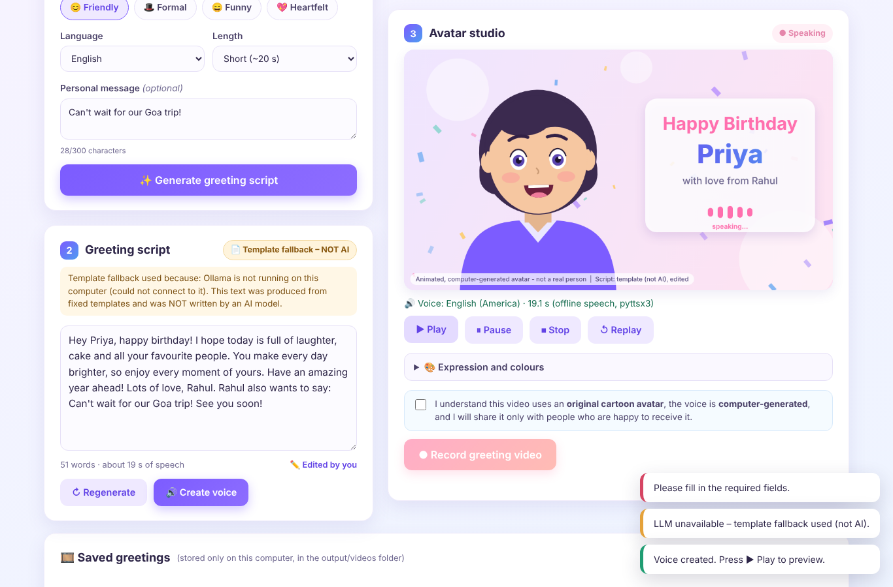

# 🎉 AI Avatar Greeting Studio — PS 36

**AI Avatar Greeting Video Generator** — a B.Tech CSE project that turns a few details
(recipient, sender, occasion, tone, language, personal message) into a **short personalised
greeting video** of an animated cartoon avatar speaking the greeting.

| Step | What happens | Technology | Is it AI? |
|---|---|---|---|
| 1. Script | A **local LLM** writes a personalised greeting | Ollama + `qwen2.5:1.5b` | ✅ Yes (LLM) |
| 1b. Fallback | Only if the LLM is unavailable: fixed templates, clearly labelled **"NOT AI"** | Python string templates | ❌ No |
| 2. Voice | The script becomes a real `.wav` speech file, offline | pyttsx3 + Windows SAPI5 voices | ❌ Rule-based speech engine |
| 3. Avatar | An original 2D cartoon blinks, smiles and moves its mouth with the voice loudness | HTML Canvas + Web Audio API | ❌ No |
| 4. Video | Canvas animation + voice are recorded together into a downloadable **WebM** | `captureStream` + `MediaRecorder` | ❌ No |

**Free, offline after setup, private.** No paid APIs, no accounts, no API keys, no cloud.



---

## ⚡ Quick start (Windows 11)

1. Install **Python 3.12** from <https://www.python.org/downloads/> — tick **"Add python.exe to PATH"**.
2. Install **Ollama** (free, no account) from <https://ollama.com/download>
   or in PowerShell: `winget install Ollama.Ollama`
3. Extract `AI_Avatar_Greeting_Studio.zip`, open the `AI-Avatar-Greeting-Studio` folder.
4. **Double-click `run_windows.bat`.** It creates a virtual environment, installs packages,
   checks Ollama and your voices, **asks before** downloading the ~1 GB model, then opens
   <http://127.0.0.1:5000> in your browser.
5. Use **Chrome or Edge**. Keep the black window open while using the app.

Manual commands, model details and every step with explanations:
**[docs/SETUP_AND_RUN.md](docs/SETUP_AND_RUN.md)**.

### The selected model
| | |
|---|---|
| Model | `qwen2.5:1.5b` (Qwen2.5 1.5B Instruct, by Alibaba Cloud) |
| Download | **986 MB** (Q4_K_M quantisation), ~1.1 GB disk |
| License | **Apache License 2.0** |
| Hardware | Runs on CPU, no graphics card needed. 8 GB RAM recommended |
| Internet | Needed once to download; generation is **offline** afterwards |

---

## 📁 Project structure

```text
AI-Avatar-Greeting-Studio/
├── app.py                  Flask web server and API routes
├── config.py               All settings in one place (model name, timeouts, options)
├── check_setup.py          Setup checker (Python, packages, Ollama, model, voices, FFmpeg)
├── run_windows.bat         One-click setup + start for Windows 11
├── run_tests.bat           Runs the automated tests
├── requirements.txt        Python packages (Flask, requests, pyttsx3, pytest)
├── pytest.ini              Test settings
├── services/
│   ├── validators.py       Input checking and cleaning
│   ├── llm_service.py      Talks to Ollama (the local LLM)
│   ├── script_generator.py Prompt building, output cleaning, fallback decision
│   ├── template_generator.py  NON-AI fallback greetings
│   ├── tts_service.py      Speech: voice choice, timeouts, .wav output
│   ├── tts_worker.py       Runs pyttsx3 in a separate process
│   └── video_store.py      Gallery: save/list/delete videos, optional MP4 & ffprobe
├── templates/index.html    The single web page
├── static/
│   ├── css/style.css       Lavender/purple design
│   ├── img/logo.svg        Original logo
│   └── js/
│       ├── avatar.js       Canvas avatar (drawing + animation)
│       ├── voice.js        Audio playback + loudness (Web Audio API)
│       ├── recorder.js     Canvas + audio → WebM (MediaRecorder)
│       └── app.js          Page logic, calls the API
├── tests/                  166 automated tests + optional browser check
├── output/                 Your speech files and videos (created automatically)
└── docs/                   All documentation (see below)
```

## 📚 Documentation

| File | Use it for |
|---|---|
| [SETUP_AND_RUN.md](docs/SETUP_AND_RUN.md) | Installing and running, step by step |
| [PROJECT_OVERVIEW.md](docs/PROJECT_OVERVIEW.md) | What the project is and how it works |
| [COMPLETE_PROJECT_STUDY_GUIDE.md](docs/COMPLETE_PROJECT_STUDY_GUIDE.md) | Learning every file, technology and concept |
| [TECHNICAL_DOCUMENTATION.md](docs/TECHNICAL_DOCUMENTATION.md) | Routes, functions, data formats, design decisions |
| [JURY_PREPARATION.md](docs/JURY_PREPARATION.md) | Pitches, demo script, 60+ questions and answers |
| [PRESENTATION_SCRIPT.md](docs/PRESENTATION_SCRIPT.md) | Slide-by-slide content and speaking script |
| [FLOWCHARTS.md](docs/FLOWCHARTS.md) | Mermaid diagrams |
| [TROUBLESHOOTING.md](docs/TROUBLESHOOTING.md) | Fixes for common problems |
| [FREE_TOOLS_AND_LICENSES.md](docs/FREE_TOOLS_AND_LICENSES.md) | Licenses, offline behaviour |
| [TEST_REPORT.md](docs/TEST_REPORT.md) | What was tested, results, and what is unverified |

## ⚠️ Honest limitations
* Lip-sync is **approximate** (mouth follows voice loudness, not phonemes).
* The avatar is an **original cartoon**, not photorealistic; no real person's likeness is used.
* Speech quality depends on the voices installed in Windows. Hindi (Devanagari) speech needs a
  Hindi voice that pyttsx3 can see; otherwise use **Hinglish**.
* A 1.5B model is small: greetings are usually good but can occasionally be generic or slightly
  off; you can always **edit** or **regenerate**.
* See [docs/TEST_REPORT.md](docs/TEST_REPORT.md) for exactly what was and was not verified.
