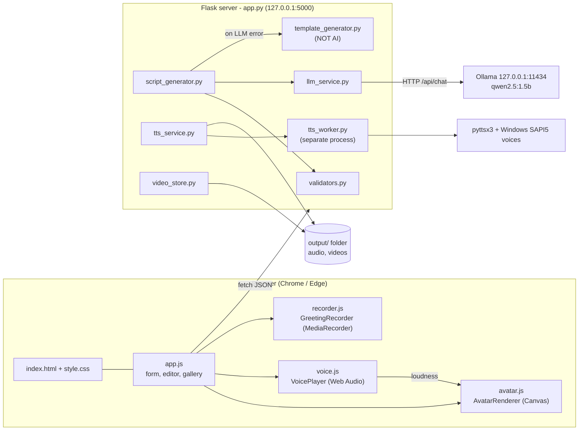
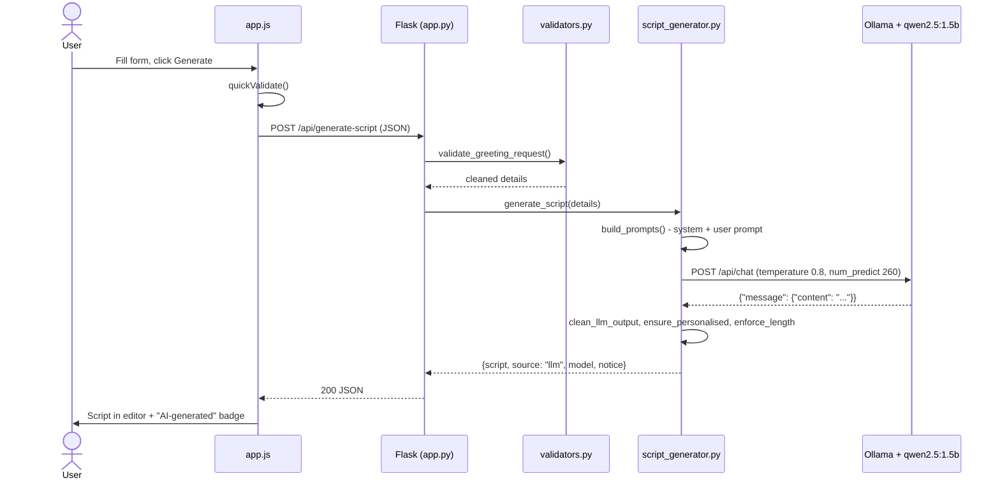
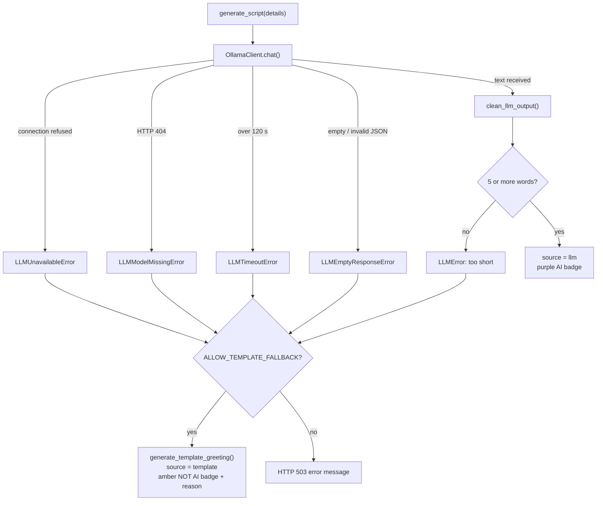
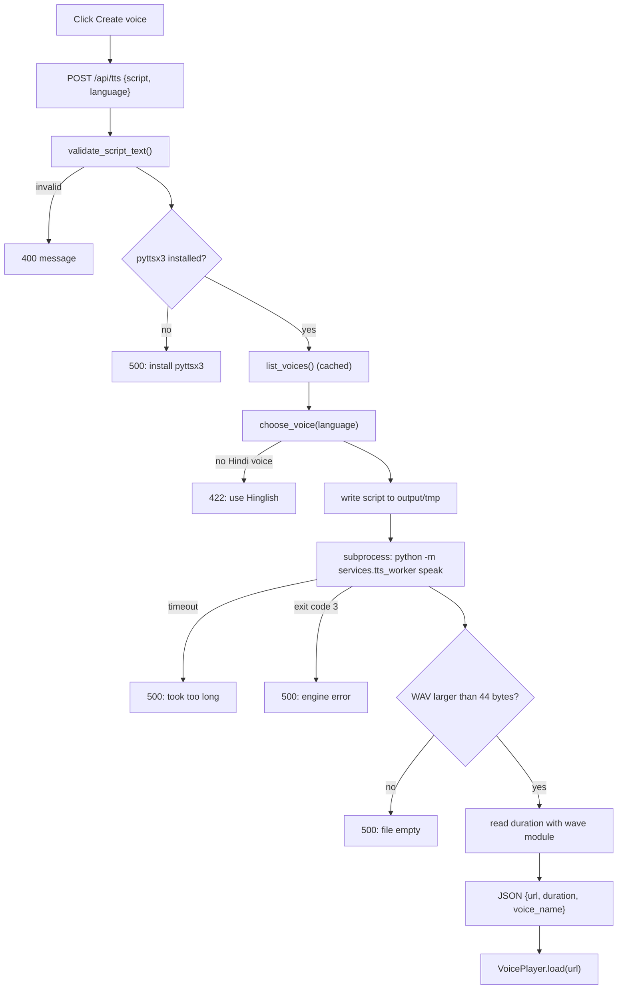
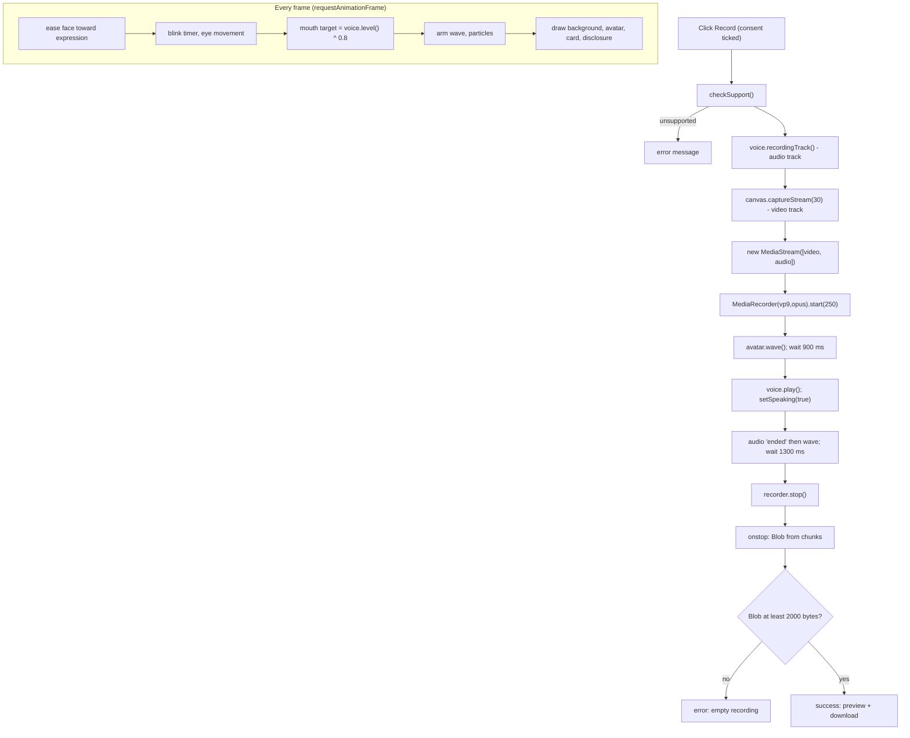
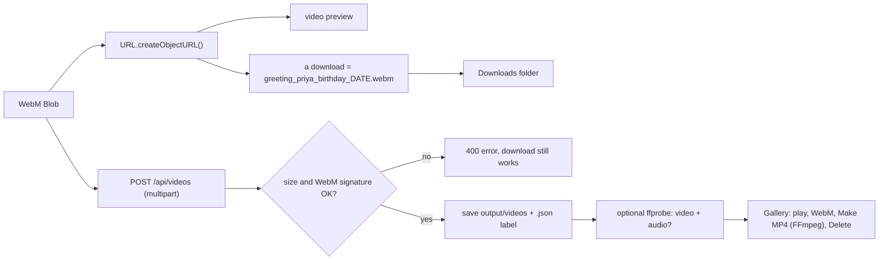
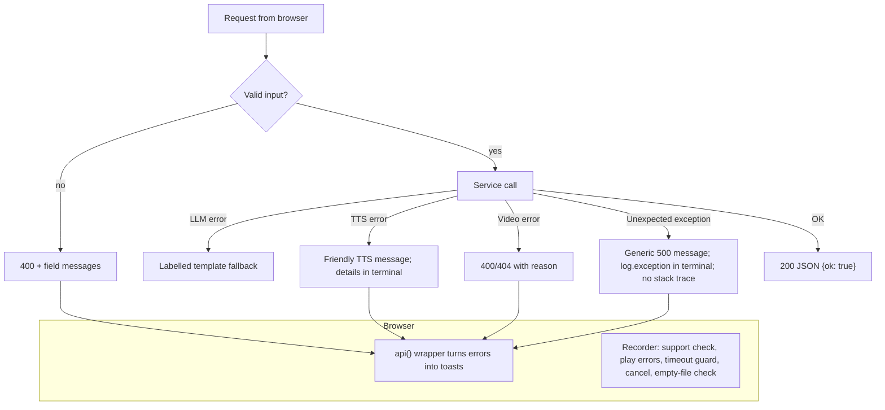

# Flowcharts (Mermaid)

These diagrams render on GitHub, in VS Code (with a Mermaid extension) or at <https://mermaid.live>
(paste the code — rendering happens in your browser).

## 1. Application architecture

## 2. LLM-based greeting generation

## 3. LLM failure and template fallback

## 4. Text-to-speech

## 5. Avatar animation and recording

## 6. Video download and gallery

## 7. Error handling (overview)

